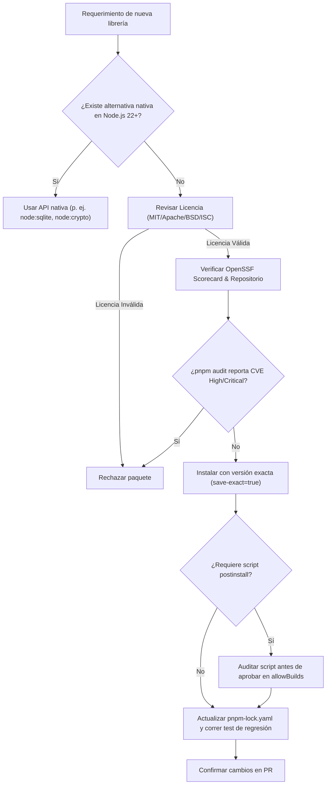

# Estándar Internacional de Seguridad de Paquetes y Cadena de Suministro (Supply Chain Security)

**Código:** WXG-SEC-001  
**Versión:** 1.0.0  
**Estado:** Activo  
**Alcance:** Proyecto WuxiaGraph (Backend, Core, CLI y Submódulos)  
**Gestor de Paquetes Homologado:** `pnpm` (>= 12.x)

---

## 1. Propósito y Objetivos

El presente documento establece los criterios y requisitos técnicos obligatorios para la evaluación, incorporación, fijación (pinning) y auditoría continua de dependencias externas (paquetes npm/pnpm) en **WuxiaGraph**.

El objetivo es blindar la cadena de suministro de software (*Software Supply Chain*) contra vectores de ataque comunes:
- **Inyección de código malicioso en scripts de instalación** (`preinstall`, `postinstall`).
- **Typosquatting** y suplantación de nombres de paquetes.
- **Toma de control de cuentas de mantenedores** (*Account Takeover*).
- **Vulnerabilidades conocidas (CVEs)** y dependencias sin mantenimiento (*abandonware*).
- **Riesgos legales y de licenciamiento** (incompatibilidad de licencias o licencias virales restrictivas).

---

## 2. Marcos de Referencia Internacionales

Este estándar se fundamenta en las mejores prácticas de la industria y estándares abiertos internacionales:

1. **OpenSSF Scorecard (Open Source Security Foundation):**  
   Métrica automatizada para evaluar la postura de seguridad y salud de repositorios de código abierto (prácticas de desarrollo, CI/CD, revisiones de código, firmas de artefactos y políticas de seguridad).
2. **SLSA (Supply Chain Levels for Software Artifacts) v1.0:**  
   Marco de integridad de artefactos que garantiza la procedencia verificable (*provenance*), inmutabilidad y trazabilidad desde el código fuente hasta el paquete distribuido en el registro.
3. **OWASP SCVS (Software Component Verification Standard) & OWASP Top 10 (A06:2021 - Vulnerable and Outdated Components):**  
   Pautas para inventario de componentes (SBOM), análisis de dependencias conocidas y verificación de integridad.
4. **Criterios de Auditoría CVE y CVSS v3.1 / v4.0:**  
   Umbrales estrictos de tolerancia ante vulnerabilidades públicas reportadas en la base de datos nacional de vulnerabilidades (NVD) y GitHub Advisory Database.

---

## 3. Criterios Obligatorios para la Aceptación de Paquetes

Todo paquete incorporado como dependencia directa (`dependencies` o `devDependencies`) debe satisfacer los siguientes requisitos:

### 3.1. Umbrales de Vulnerabilidad (CVE / CVSS)

| Nivel de Severidad (CVSS) | Puntuación Base | Política de Admisión | SLA de Remediación / Parcheo |
| :--- | :--- | :--- | :--- |
| **Critical** | 9.0 - 10.0 | **Tolerancia Cero (Bloqueo absoluto)** | Inmediato (bloquea CI/CD) |
| **High** | 7.0 - 8.9 | **Tolerancia Cero (Bloqueo absoluto)** | Máximo 24-48 horas |
| **Medium** | 4.0 - 6.9 | Requiere justificación técnica o mitigación | Máximo 15 días calendario |
| **Low** | 0.1 - 3.9 | Permitido con monitoreo activo | Próximo ciclo de mantenimiento |

> **Regla de CI:** El comando `pnpm audit` debe ejecutarse en el pipeline y finalizar con código de salida `0` (sin vulnerabilidades conocidas High o Critical).

### 3.2. Salud del Proyecto y OpenSSF Scorecard

Para dependencias de producción (`dependencies`), se evalúan los siguientes indicadores:
1. **Puntaje Scorecard mínimo:** Se recomienda un puntaje $\ge 7.0/10$ en [OpenSSF Scorecard](https://scorecard.dev/).
2. **Mantenimiento Activo:** Al menos una versión o commit en los últimos 12 meses; issues críticos atendidos por el equipo mantenedor.
3. **Firmas y Procedencia (SLSA / npm Provenance):** Preferencia mandatoria por paquetes que publican atestaciones de procedencia firmadas mediante Sigstore (`npm publish --provenance`).
4. **Protección contra Typosquatting:**
   - La antigüedad del paquete en el registro npm debe ser superior a 30 días.
   - Cantidad significativa de descargas semanales y reputación verificable.
   - Verificación de la URL del repositorio oficial contra el paquete publicado.

### 3.3. Cumplimiento de Licenciamiento (License Compliance)

Se establece una lista blanca estricta de licencias de código abierto compatibles con el modelo comercial y arquitectónico de WuxiaGraph:

- **Licencias Permitidas (Permisivas):**
  - MIT
  - Apache-2.0
  - BSD-2-Clause / BSD-3-Clause
  - ISC
  - CC0-1.0 / Unlicense
- **Licencias Restringidas / Prohibidas (Copyleft Viral sin aprobación previa):**
  - GPLv2 / GPLv3
  - AGPLv3 (Affero General Public License)
  - SSPL (Server Side Public License)
  - Licencias no aprobadas por OSI (*Open Source Initiative*).

---

## 4. Arquitectura de Configuración y Control en `pnpm`

Para hacer cumplir este estándar de manera automatizada y determinista en el repositorio, se aplican las siguientes directivas de configuración:

### 4.1. Versiones Congeladas y Estrictas (Strict Version Pinning)

En `package.json`, todas las versiones de dependencias deben declararse de forma **exacta**, sin comodines dinámicos (`^`, `~`, `*`, `x`):
```json
{
  "dependencies": {
    "hono": "4.13.13",
    "zod": "4.6.7"
  }
}
```

Para asegurar que cualquier comando futuro respete esta política, `.npmrc` debe contener:
```ini
save-exact=true
engine-strict=true
```

### 4.2. Bloqueo de Scripts Arbitrarios de Instalación (`allowBuilds`)

Uno de los vectores más comunes de ataque en npm son los scripts de ciclo de vida (`preinstall`, `install`, `postinstall`).
En pnpm (v12+):
- La ejecución de scripts de construcción está deshabilitada por defecto para paquetes nuevos.
- Solo los paquetes expresamente auditados y aprobados mediante `pnpm approve-builds` pueden figurar en la lista blanca de compilación (`allowBuilds` en `pnpm-workspace.yaml`):
```yaml
allowBuilds:
  esbuild: true
```

### 4.3. Determinismo del Lockfile (`pnpm-lock.yaml`)

- El archivo `pnpm-lock.yaml` es el único registro de verdad del árbol de dependencias resuelto y sus hashes criptográficos (`integrity: sha512-...`).
- En entornos de Integración Continua (CI/CD) y producción, las dependencias deben instalarse exclusivamente con:
```bash
pnpm install --frozen-lockfile
```
- Cualquier discrepancia entre `package.json` y `pnpm-lock.yaml` causará la falla inmediata de la construcción.

---

## 5. Scripts Estándar del Proyecto

El archivo `package.json` debe exponer los siguientes comandos unificados:

- `pnpm run dev`: Inicia el entorno de desarrollo local con recarga en caliente (`tsx watch`).
- `pnpm run build`: Valida tipos y compila TypeScript en modo estricto hacia `./dist` (`tsc`).
- `pnpm run test`: Ejecuta la suite de pruebas unitarias y de integración mediante `vitest run`.
- `pnpm run audit`: Inspecciona el árbol de dependencias instalado contra la base de datos de vulnerabilidades activas (`pnpm audit`).

---

## 6. Procedimiento para Incorporar o Actualizar Paquetes

Antes de ejecutar `pnpm add <paquete>`, el ingeniero o agente responsable debe seguir el siguiente flujo de verificación:



1. **Prioridad Nativa:** Antes de añadir dependencias, verificar si la funcionalidad ya está soportada nativamente en Node.js (ej. `node:sqlite`, `node:crypto`, `node:test`, `fetch`).
2. **Auditoría Preliminar:** Comprobar que no existan avisos de seguridad abiertos.
3. **Instalación:** Ejecutar `pnpm add <paquete>` asegurando el guardado exacto de versión.
4. **Verificación de Seguridad:** Ejecutar `pnpm audit` y `pnpm run test`.
5. **Revisión del Lockfile:** Inspeccionar el diff de `pnpm-lock.yaml` en el pull request para prevenir dependencias fantasma o paquetes secundarios no deseados.
